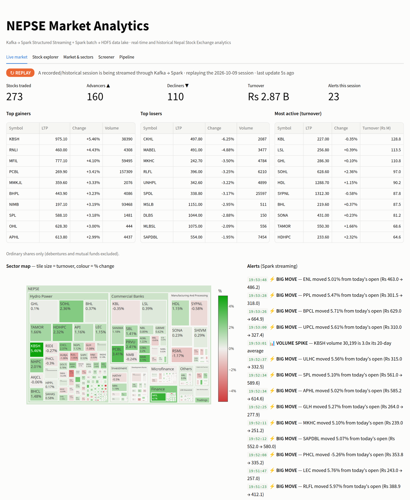
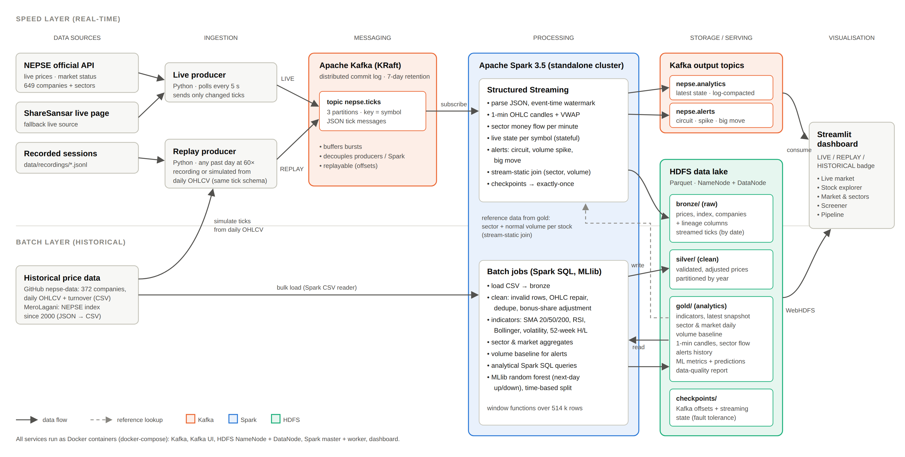
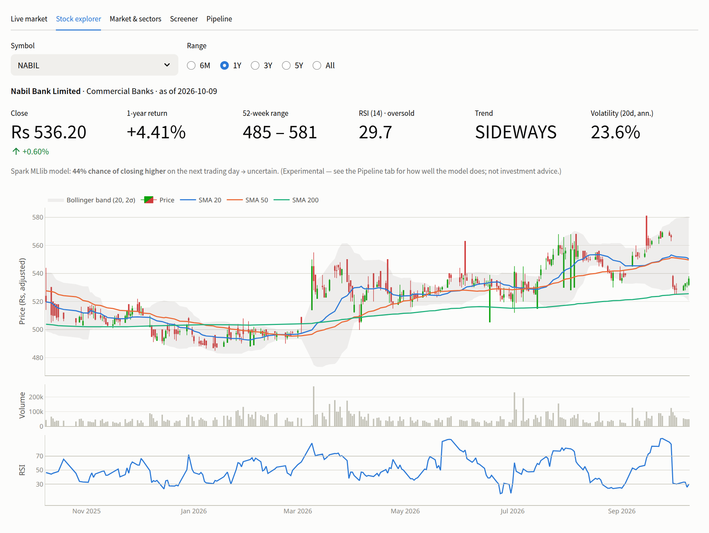
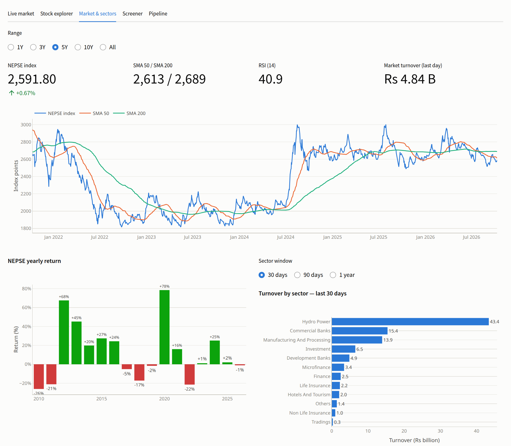
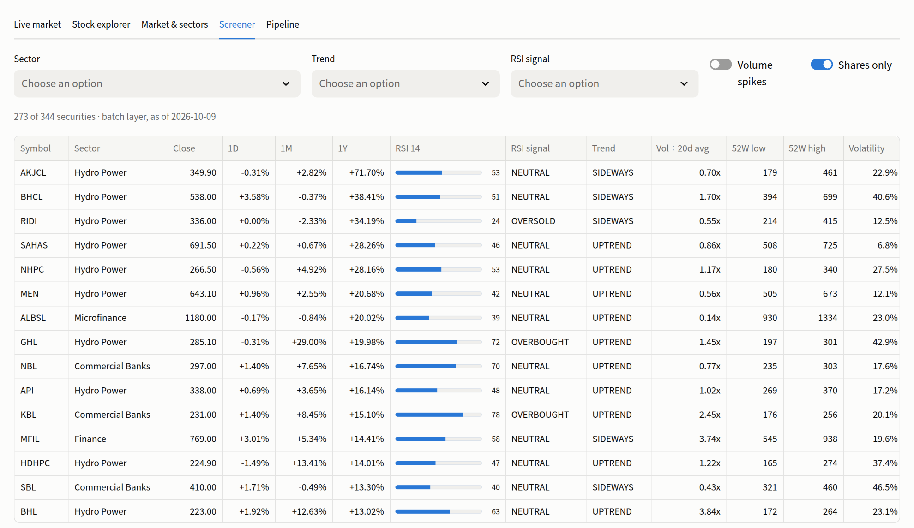
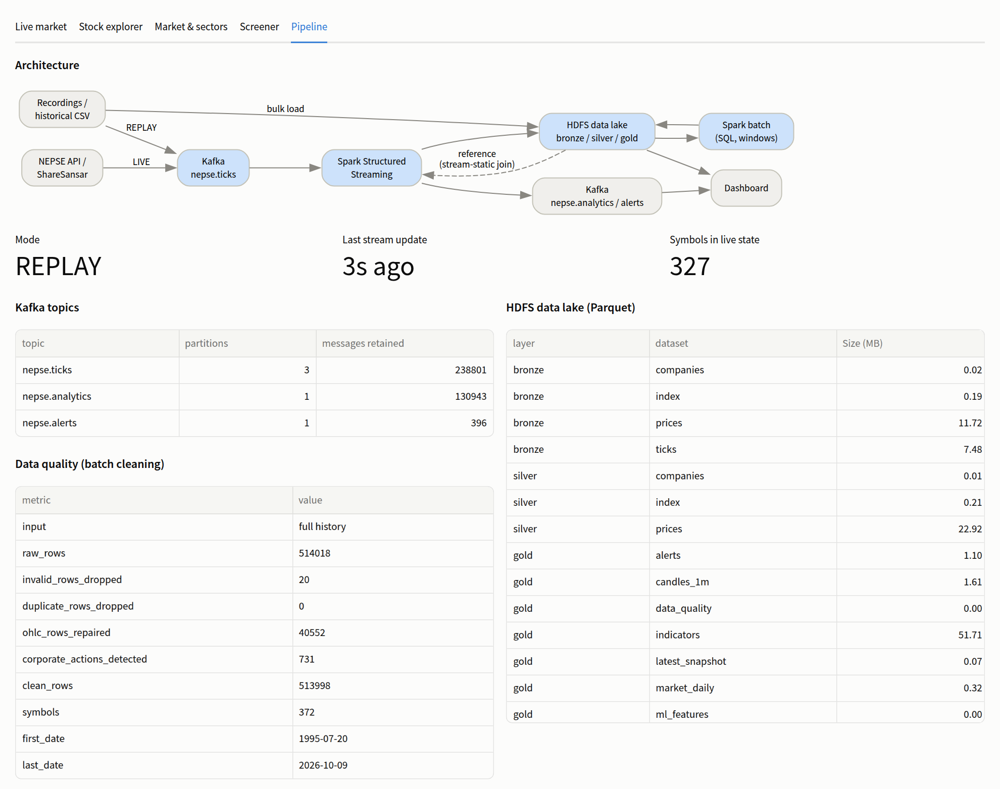
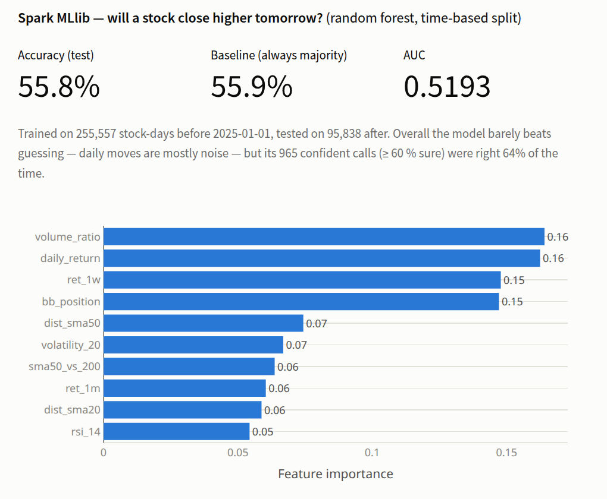

<div align="center">

# NEPSE Kafka–Spark Pipeline

**Real-time and historical analytics for the Nepal Stock Exchange, built on a big data stack**

[](https://kafka.apache.org/)
[](https://spark.apache.org/)
[](https://hadoop.apache.org/)
[](https://www.python.org/)
[](https://docs.docker.com/compose/)
[](https://streamlit.io/)

Big Data Technology project · Institute of Engineering, Pulchowk Campus

[Architecture](#architecture) · [Quick start](#quick-start) · [Dashboard](#dashboard) · [Results](#results) · [Report](#project-report)



</div>

---

## Overview

NEPSE prices are published on several websites, but none of them combine **live market monitoring** with **long-term historical context**. This project builds that view with a Lambda-style big data pipeline:

- **Apache Kafka** ingests live price ticks from the NEPSE API, or replays any past trading day when the market is closed.
- **Spark Structured Streaming** turns ticks into 1-minute candles, sector money flow, a live market snapshot and alerts for circuit hits, volume spikes and big intraday moves.
- **Spark batch jobs** clean 31 years of history (1995–2026) and compute technical indicators with Spark SQL, plus a next-day direction model in Spark MLlib.
- **HDFS** stores everything as Parquet in a bronze → silver → gold data lake.
- A **Streamlit dashboard** shows live, replayed and historical views.

The whole system runs in Docker on one laptop and works **fully offline** once the images are built.

### Highlights

| | |
|---|---|
| **514,018** daily price records, **372** companies, **1995 → 2026** | cleaned in Spark: 40,552 rows repaired, **731** bonus/right-share adjustments detected and back-adjusted |
| **15,142** ticks for **327** symbols in one replayed trading day | streamed through Kafka and Spark in about 4 minutes at 60× speed |
| **Exactly-once** recovery | streaming job killed mid-session → 15,142 of 15,142 ticks stored, none lost or duplicated |
| **Three modes, one pipeline** | `LIVE` (market open) · `REPLAY` (any past day) · `HISTORICAL` (batch layer) |
| **Log-compacted** serving topic | dashboard start-up catch-up cut from 19.2 s to 1.4 s |

---

## Architecture

<p align="center">
  
</p>

| Layer | Component | What it does |
|-------|-----------|--------------|
| Sources | NEPSE API, ShareSansar, GitHub `nepse-data`, MeroLagani | Live prices, company list, daily history, NEPSE index |
| Ingestion | Python producers → **Kafka** `nepse.ticks` | LIVE polling every 5 s, or REPLAY of a recorded or simulated day |
| Speed layer | **Spark Structured Streaming** | Event-time windows, stateful live snapshot, alerts, stream-static join with batch data |
| Batch layer | **Spark SQL + MLlib** | Cleaning, corporate-action adjustment, indicators, sector/market aggregates, ML model |
| Storage | **HDFS** (Parquet) | `bronze/` raw · `silver/` clean · `gold/` analytics · `checkpoints/` |
| Serving | Kafka `nepse.analytics` (compacted), `nepse.alerts`; WebHDFS | Feeds the dashboard |
| UI | **Streamlit** + Plotly | Live market, stock explorer, market & sectors, screener, pipeline |

---

## Quick start

**Requirements:** Docker with Docker Compose v2, about 8 GB of RAM and 6 GB of disk. Nothing else: the Python scripts also run in containers.

```bash
git clone https://github.com/santoshtiwari41/-nepse-kafka-spark-pipeline.git nepse-kafka-spark-pipeline
cd nepse-kafka-spark-pipeline

./scripts/start.sh        # build/pull images and start Kafka, HDFS, Spark and the dashboard
./scripts/verify.sh       # health check + Spark ↔ Kafka ↔ HDFS smoke test
./scripts/run_batch.sh    # history → bronze → silver → gold → MLlib → Spark SQL (~5 min)
./scripts/demo.sh         # guided demo: streaming, LIVE or REPLAY, fault tolerance
```

Then open the dashboard at **http://localhost:8501**.

Without downloading anything, the pipeline uses the committed 42-stock sample in `data/sample/`. For the full history of every company:

```bash
./scripts/ingest.sh fetch_companies
./scripts/ingest.sh fetch_history
```

| Service | Address |
|---------|---------|
| Dashboard | http://localhost:8501 |
| Kafka UI | http://localhost:8085 |
| HDFS NameNode | http://localhost:9870 |
| Spark master / streaming UI | http://localhost:8080 / http://localhost:4040 |

---

## Dashboard

<table>
  <tr>
    <td width="50%"><br><sub><b>Stock explorer</b>: bonus-adjusted candlesticks, SMA 20/50/200, Bollinger band, volume, RSI</sub></td>
    <td width="50%"><br><sub><b>Market &amp; sectors</b>: NEPSE index with moving averages, yearly returns, sector turnover</sub></td>
  </tr>
  <tr>
    <td width="50%"><br><sub><b>Screener</b>: every security, filtered by sector, trend, RSI signal and volume spike</sub></td>
    <td width="50%"><br><sub><b>Pipeline</b>: architecture, Kafka topic sizes, HDFS datasets, data-quality report</sub></td>
  </tr>
</table>

The badge on the Live market tab shows the current mode: **LIVE** while NEPSE is open, **REPLAY** (naming the day being replayed) when a past session is streamed, and **HISTORICAL** when no stream is running.

---

## How it works

### Operating modes

NEPSE trades only about four hours per working day, so the pipeline never depends on the market being open.

| Mode | Data path | Command |
|------|-----------|---------|
| **LIVE** | NEPSE API → live producer → Kafka → Spark Streaming | `./scripts/ingest.sh live_producer` |
| **REPLAY** | Recorded or simulated day → replay producer → Kafka → Spark Streaming | `./scripts/ingest.sh replay_producer --loop` |
| **HISTORICAL** | History CSV → Spark batch → HDFS gold | `./scripts/run_batch.sh` |

A replay simulates intraday trades from each stock's daily open, high, low, close and volume; the path ends exactly at the real close and volume. Timestamps are shifted to the current time, so Spark sees a fresh stream, and every replay loop is its own session.

### Batch layer

- **Cleaning:** invalid rows are dropped, duplicates removed and high/low repaired so they contain the open and close.
- **Corporate actions:** NEPSE's daily price limit is ±10 %, so an opening gap below −10.5 % is a bonus or right-share adjustment rather than trading. Earlier prices are back-adjusted, so charts and indicators show no artificial crashes.
- **Indicators:** SMA 20/50/200, RSI 14, Bollinger bands, 20-day volatility, 52-week high/low, 1-week to 1-year returns, volume ratio, golden/death crosses and trend.
- **Spark SQL:** nine analytical queries (`./scripts/spark_submit.sh batch_queries.py`), from top gainers to NEPSE's yearly returns.

### Speed layer

| Streaming query | Output | Technique |
|-----------------|--------|-----------|
| `ticks` | HDFS `bronze/ticks` | Exactly-once Parquet file sink |
| `candles_1m` | HDFS `gold/candles_1m` | 1-minute event-time windows, 10 s watermark, OHLC + VWAP |
| `sector_flow` | HDFS `gold/sector_flow_1m` | Windowed turnover per sector |
| `live_snapshot` | Kafka `nepse.analytics` | Stateful latest tick per symbol per session |
| `alerts` | Kafka `nepse.alerts` + HDFS | Circuit (±9.5 %), volume spike (≥ 3× normal), big move (≥ 5 % from open) |

### Storage

```
/nepse/bronze        raw data as received, with lineage columns; streamed ticks
/nepse/silver        cleaned, bonus-adjusted prices (partitioned by year)
/nepse/gold          indicators, snapshots, sector/market history, candles, alerts, ML results
/nepse/checkpoints   Kafka offsets and streaming state for exactly-once recovery
```

Parquet stores the 33 MB of raw price CSV in 11.7 MB. Tables are partitioned by year rather than by day, which avoids the HDFS small-files problem.

---

## Results

<table>
  <tr>
    <td width="55%" valign="top">

| Metric | Value |
|--------|------:|
| Raw price rows | 514,018 |
| Invalid rows dropped | 20 |
| OHLC rows repaired | 40,552 |
| Bonus/right-share adjustments | 731 |
| Clean rows | 513,998 |
| Replay day ticks / symbols | 15,142 / 327 |
| Ticks after crash and restart | 15,142 of 15,142 |
| Batch layer (full history) | ≈ 5.5 min |

</td>
    <td width="45%" valign="top"></td>
  </tr>
</table>

The **Spark MLlib** random forest predicts whether a stock closes higher the next day. It was trained on 2015–2024 and tested on 2025 onward. Its accuracy of 55.8 % matches the 55.9 % baseline of always predicting the majority class, and its AUC is 0.519. Daily price moves are close to random, so this part demonstrates a leakage-free distributed ML pipeline rather than a trading signal.

---

## Project report

The full report covers the problem, data sources, features, storage design, choice of components, block diagram, implementation, results and limitations:

- [`report/NEPSE_BigData_Project_Report.pdf`](report/NEPSE_BigData_Project_Report.pdf): print-ready PDF, A4, 38 pages
- [`report/NEPSE_BigData_Project_Report.docx`](report/NEPSE_BigData_Project_Report.docx): the same report in Word
- [`report/NEPSE_BigData_Project_Report.html`](report/NEPSE_BigData_Project_Report.html): the same report as a single web page (download it and open it in a browser)
- [`plan.md`](plan.md): the original design document

---

## Reference

<details>
<summary><b>All scripts</b></summary>

| Script | Purpose |
|--------|---------|
| `./scripts/start.sh` | Start the stack and create Kafka topics and HDFS directories |
| `./scripts/stop.sh` | Stop the stack (`--clean` also deletes Kafka and HDFS data) |
| `./scripts/verify.sh` | Health check and Spark ↔ Kafka ↔ HDFS smoke test |
| `./scripts/run_batch.sh` | Full batch layer (`--source sample` for the offline sample) |
| `./scripts/stream.sh start\|stop\|status\|logs\|reset` | Manage the Spark streaming job |
| `./scripts/ingest.sh <script> [args]` | Run a Python ingestion script in its container |
| `./scripts/spark_submit.sh <job.py> [args]` | Run any Spark job in `spark/jobs/` |
| `./scripts/demo.sh [--replay] [--speed N] [--date D] [--batch]` | Guided, step-by-step demo |

</details>

<details>
<summary><b>Data collection and producers</b></summary>

```bash
./scripts/ingest.sh fetch_companies                      # 649 securities with sector → data/reference/
./scripts/ingest.sh fetch_history                        # ~370 companies + NEPSE index → data/historical/
./scripts/ingest.sh build_sample                         # offline sample → data/sample/

./scripts/ingest.sh live_producer                        # wait for market open, stream to Kafka
./scripts/ingest.sh live_producer --no-kafka             # only record today's session to data/recordings/

./scripts/ingest.sh replay_producer --list               # what can be replayed
./scripts/ingest.sh replay_producer --loop               # latest trading day at 60×, repeated
./scripts/ingest.sh replay_producer --date 2026-10-09 --speed 10
./scripts/ingest.sh replay_producer --source recording   # a recorded live session
```

Every Kafka message on `nepse.ticks` (key = symbol) has the same shape in every mode:

```json
{"symbol": "NABIL", "ts": "2026-10-09T14:59:59+05:45", "ltp": 536.2, "open": 532.0, "high": 538.0,
 "low": 531.0, "prev_close": 533.0, "volume": 48779, "turnover": 26163739.6, "last_qty": 10,
 "change_pct": 0.6, "source": "nepse-api", "mode": "LIVE",
 "session_start": "2026-10-09T11:00:00+05:45", "session_date": "2026-10-09"}
```

</details>

<details>
<summary><b>Kafka topics</b></summary>

| Topic | Partitions | Cleanup | Content |
|-------|-----------:|---------|---------|
| `nepse.ticks` | 3 | delete (7 days) | Raw LIVE or REPLAY ticks, keyed by symbol |
| `nepse.analytics` | 1 | **compact** | Latest state per symbol from Spark |
| `nepse.alerts` | 1 | delete (7 days) | Circuit, volume-spike and big-move alerts |

</details>

<details>
<summary><b>Project structure</b></summary>

```
docker-compose.yml      all services (Kafka, Kafka UI, HDFS, Spark, dashboard, ingestion tools)
config/hadoop.env       HDFS configuration
ingestion/              Python ingestion: fetch_*.py, live_producer.py, replay_producer.py, Dockerfile
spark/                  Spark image (Kafka connector built in), configuration and PySpark jobs
dashboard/              Streamlit app (app.py = UI, data.py = Kafka + WebHDFS access)
scripts/                start, stop, verify, run_batch, stream, ingest, spark_submit, demo
data/                   sample/ and reference/ (in git); historical/ and recordings/ (downloaded)
report/                 project report (Word + HTML), figures and the generator build.js
plan.md                 design document
```

</details>

<details>
<summary><b>Troubleshooting</b></summary>

- **Port already in use:** change the left side of the port mapping in `docker-compose.yml`.
- **NameNode stuck in safe mode:** `docker exec namenode hdfs dfsadmin -safemode leave`.
- **Dashboard shows HISTORICAL while replaying:** the stream is not running (`./scripts/stream.sh status`).
- **Nothing new after code changes to the stream:** `./scripts/stream.sh stop && ./scripts/stream.sh reset && ./scripts/stream.sh start`.
- **Edited `spark/conf/*` or `config/hadoop.env`:** `docker compose restart spark-master spark-worker`.
- **Changed a Dockerfile or `requirements.txt`:** `docker compose build` (needs internet), then `./scripts/start.sh`.
- **Start from scratch:** `./scripts/stop.sh --clean && ./scripts/start.sh`.

</details>

---

## Team

| | |
|---|---|
| **Santosh Tiwari** (082MSDSA024) | Ingestion and storage |
| **Arbind Sah** (082MSDSA006) | Processing and visualisation |
| **Supervisor** | Basanta Joshi |

Big Data Technology · Institute of Engineering, Pulchowk Campus, Tribhuvan University

## Acknowledgements

- [Aabishkar2/nepse-data](https://github.com/Aabishkar2/nepse-data) for daily price history
- [basic-bgnr/NepseUnofficialApi](https://github.com/basic-bgnr/NepseUnofficialApi) for access to the NEPSE live API
- [MeroLagani](https://merolagani.com) (NEPSE index) and [ShareSansar](https://www.sharesansar.com) (fallback live prices)

> This is an academic project. It uses public, unofficial data sources and nothing in it is investment advice.
